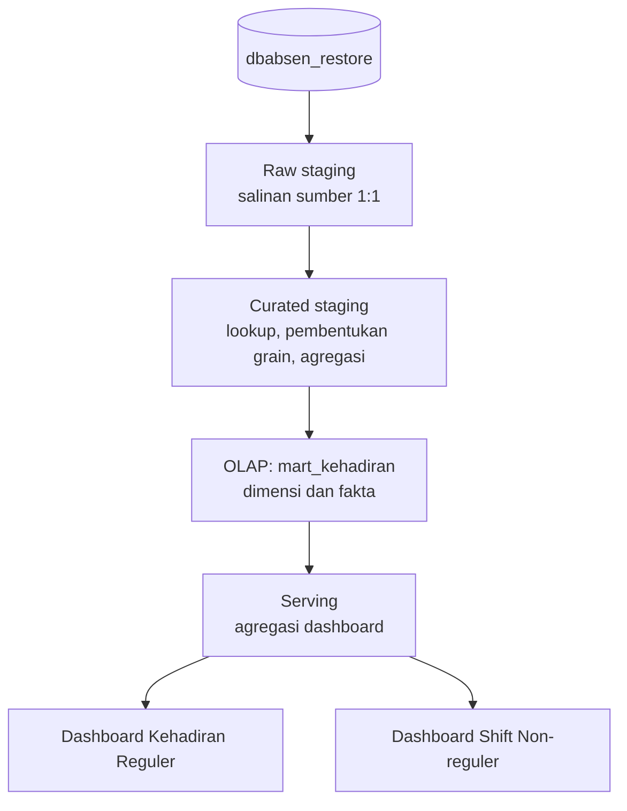

# Data Lineage Dashboard KPI E-Presensi

Dokumen ini menetapkan lineage untuk dashboard kehadiran dengan filter **tanggal
harian** dan **departemen**.

## 1. Keputusan rancangan

1. Data dari `dbabsen_restore` diterima apa adanya: tanpa cleaning,
   standardisasi, penggantian nilai, atau normalisasi nilai bisnis.
2. Curated staging hanya melakukan lookup relasi, pembentukan grain, ekspansi
   tanggal izin bila dibutuhkan, dan agregasi event.
3. `mart_kehadiran` adalah satu logical data mart yang berisi dimensi, fakta
   kehadiran regular, dan fakta kehadiran non-regular.
4. Tabel agregasi khusus konsumsi dashboard ditempatkan di schema `serving`.
   Dashboard tidak membaca raw, curated, atau fakta mart secara langsung.

Satu logical mart tidak berarti satu tabel fisik. Fakta dan dimensi tetap
terpisah karena grain dan siklus pemuatannya berbeda.

## 2. Kontrak filter dan grain

| Filter | Kunci | Aturan |
|---|---|---|
| Tanggal | `fact_kehadiran.tanggal` | Satu hari kerja, diturunkan langsung dari tanggal event sumber yang sudah menggunakan Asia/Jakarta. |
| Departemen | `fact_kehadiran.departemen_id` / `departemen_key` | Berdasarkan ID, bukan nama. Nama dapat berulang pada `m_departemen`. |
| Grain dashboard reguler | satu pegawai × satu tanggal kerja | Satu baris hanya boleh dihitung sekali. |
| Grain dashboard non-reguler | satu pegawai × satu tanggal × jadwal non-reguler | Perlu diringkas lagi ke pegawai × tanggal sebelum menghitung orang; seorang pegawai dapat memiliki lebih dari satu event/jadwal. |

Gunakan filter tanggal tertutup: `tanggal = :tanggal` untuk dashboard harian.
Filter departemen bersifat opsional; nilai `ALL` tidak membatasi `departemen_id`.
Tanggal yang belum ditutup/reconciled harus diberi label **provisional**.

## 3. Arsitektur dan lineage end-to-end



### 3.1 Sumber OLTP yang diverifikasi

| Domain | Tabel dan kolom sumber | Peran |
|---|---|---|
| Organisasi dan pegawai | `m_departemen(id, kode, nama_departemen, ...)`; `m_pegawai(id, departemen, status, ...)` | Dimensi departemen dan populasi pegawai. |
| Jadwal | `m_shift(id, nama, status, departemen_id, is_flexible, ...)`; `m_jadwal(id, jenis, hari, jam_masuk, jam_keluar, ...)` | Klasifikasi regular/non-reguler dan jadwal pembanding. `m_jadwal.jenis → m_shift.id`. |
| Event presensi | `t_checkinout(id, pegawai_id, departemen, checktype, created_at, updated_at, is_wfh, work_code, jadwal_id, jam_masuk, jam_keluar, is_manual, ...)` | Bukti check-in (`checktype=1`), check-out (`checktype=2`), mode kerja, jadwal transaksi, dan audit. |
| Izin | `t_perizinan(id, pegawai_id, user_id, departemen, jenis_ijin, approval, approval_at, tgl_ijin, tgl_ijin_sampai, ...)`; `m_user(id, pegawai_id)`; `m_jenis_ijin(id, nama, tipe_id, setengah_hari, ...)`; `m_tipe_ijin(id, nama, tipe)` | Izin approved, rentang izin, identitas, dan klasifikasi izin. |
| Kalender pengecualian | `m_hari_libur(tanggal, ...)`; `t_libur_shift(pegawai_id, tanggal, ...)` | Hari libur umum dan pengecualian pegawai. |

`m_pegawai.departemen` adalah organisasi pegawai. `m_shift.departemen_id` adalah
pemilik shift dan tidak boleh menggantikan departemen pegawai tanpa aturan
penugasan yang disetujui. Untuk event, `t_checkinout.jadwal_id` harus dilookup ke
`m_jadwal.id`, lalu diverifikasi silang dengan `work_code → m_shift.id`.

## 4. Staging

### 4.1 Raw staging

| Layer | Objek | Grain | Aturan inti |
|---|---|---|---|
| Raw | `raw_checkinout`, `raw_perizinan`, `raw_pegawai`, `raw_departemen`, `raw_shift`, `raw_jadwal`, `raw_hari_libur`, `raw_libur_shift` | 1:1 sumber | Simpan PK sumber, `updated_at`/`created_at`, dan waktu ekstrak; jangan mengubah nilai bisnis. |
| Curated | `cur_event_attendance` | satu event | Lookup event ke jadwal dan jenis shift tanpa mengubah nilai sumber. |
| Curated | `cur_leave_daily` | pegawai × tanggal izin × permohonan | Ekspansi rentang izin; dipakai bila izin menjadi KPI atau pengecualian denominator. |
| Curated | `cur_employee_workday` | pegawai × tanggal | Bentuk kandidat kewajiban: Senin–Jumat, bukan `m_hari_libur`, bukan `t_libur_shift`, dan mempunyai jadwal regular. |
| Curated | `cur_attendance_regular_daily` | pegawai × tanggal | Menggabungkan kewajiban, event, izin, dan keterlambatan tanpa menjadikan status sebagai syarat metrik event. |
| Curated | `cur_nonregular_event_daily` | pegawai × tanggal × jadwal | Event non-regular dengan `has_masuk`, `has_pulang`, dan mode kerja. |

### 4.2 Curated staging

Raw staging menjawab pertanyaan **"apa yang tertulis di sumber?"** dan menyimpan
data apa adanya agar dapat diaudit dan di-load ulang. Data sumber pada tahap ini
diterima sebagai data yang sudah jelas; tidak ada proses cleaning, standardisasi
teks, penggantian nilai, atau normalisasi nilai bisnis.

Curated staging menjawab **"bagaimana data sumber digabung dan diringkas pada
grain yang aman untuk dihitung?"**. Ia hanya membentuk grain, lookup relasi,
ekspansi rentang izin, dan agregasi event menjadi pegawai-hari sebelum data
menjadi fakta/mart dashboard. Curated bukan lapisan cleaning/normalisasi dan
bukan agregat visual dashboard.

| Objek curated | Masukan | Keluaran inti | Fungsi praktis |
|---|---|---|---|
| `cur_event_attendance` | `raw_checkinout` + jadwal/shift | satu event dengan `tanggal_kerja`, `event_type`, `is_reguler`, `jadwal_id_sumber`, `is_wfh` | Lookup relasi event ke jadwal/shift tanpa mengubah nilai sumber. |
| `cur_regular_event_daily` | event regular | satu pegawai × tanggal dengan `has_masuk`, `has_pulang`, waktu masuk/pulang pertama, hitungan event, dan mode | Sumber langsung kartu check-in/check-out. `has_masuk` tidak menunggu adanya check-out. |
| `cur_leave_daily` | izin, user, jenis izin | satu pegawai × tanggal × izin | Hanya diperlukan apabila izin memengaruhi denominator, laporan izin, atau tanpa keterangan; dashboard event murni tidak membacanya. |
| `cur_employee_workday` | pegawai, kalender, libur, shift regular | satu pegawai × tanggal dengan `is_scheduled_regular`, `is_day_off` | Menentukan kandidat wajib hadir; tidak dicampur dengan event presensi. |
| `cur_attendance_regular_daily` | tiga curated di atas | satu pegawai × tanggal | Menggabungkan kewajiban dan event menjadi satu record yang siap diagregasi; ini tempat yang tepat untuk menghitung late dan denominator, bukan sumber event mentah. |

Contoh satu pegawai pada 22 Oktober:

| Keadaan sumber | `cur_regular_event_daily` | Dampak dashboard |
|---|---|---|
| Satu event `checktype=1`, belum ada keluar | `has_masuk=true`, `has_pulang=false` | Masuk bertambah satu; pulang tidak bertambah. |
| Satu event masuk dan satu event keluar | keduanya `true` | Masuk dan pulang masing-masing bertambah satu. |
| Dua event masuk atau checktype lain | jumlah event dan tipe event tetap tersimpan | Tidak dibersihkan atau diubah; aturan pelaporannya dapat ditetapkan kemudian. |
| Izin approved tanpa event | tidak ada event; `has_valid_leave=true` setelah join | Tidak menaikkan check-in/out; hanya memengaruhi denominator bila kebijakan memilih mengecualikan izin. |

### 4.3 Kontrak `cur_attendance_regular_daily` untuk dashboard event

Untuk dashboard baru, gunakan kolom berikut sebagai kontrak utama:

| Kolom | Arti | Dipakai oleh |
|---|---|---|
| `is_scheduled_regular` | Pegawai memiliki kewajiban jadwal regular pada hari tersebut, setelah akhir pekan/libur/off individual | Wajib hadir (sebelum pengecualian izin). |
| `has_masuk` | Minimal satu event masuk (`checktype=1`) regular | Jumlah check-in. |
| `has_pulang` | Minimal satu event pulang (`checktype=2`) regular | Jumlah check-out. |
| `has_valid_leave` | Ada izin approved yang identitas dan rentangnya valid | Pengecualian denominator, bila diperlukan. |
| `is_late`, `late_minutes` | Masuk valid lebih lambat dari jadwal mulai | Keterlambatan; tidak menunggu event pulang. |

`status_kehadiran` boleh tetap disimpan sebagai atribut turunan untuk audit atau
dashboard mendatang, tetapi tidak menjadi filter bagi kartu check-in/out. Jika
tetap dihitung, definisi minimumnya adalah:

```text
IZIN                = has_valid_leave
HADIR_LENGKAP       = bukan IZIN dan has_masuk dan has_pulang
CHECKIN_BELUM_PULANG = bukan IZIN dan has_masuk dan bukan has_pulang
TANPA_EVENT         = bukan IZIN dan is_scheduled_regular dan bukan has_masuk dan bukan has_pulang
REVIEW               = aturan bisnis untuk kondisi yang belum disepakati
```

`CHECKIN_BELUM_PULANG` sengaja bukan absen dan tidak disamakan dengan
`TANPA_KETERANGAN`. Dengan model ini dashboard dapat menjawab jumlah check-in dan
check-out secara jujur tanpa menghapus kasus presensi belum lengkap.

## 5. OLAP: mart_kehadiran

`mart_kehadiran` adalah logical data mart dan dapat diwujudkan sebagai schema
PostgreSQL dengan nama yang sama.

| Objek | Grain | Sumber curated | Fungsi |
|---|---|---|---|
| `mart_kehadiran.dim_calendar` | satu tanggal | kalender dan `m_hari_libur` | Dimensi tanggal |
| `mart_kehadiran.dim_departemen` | satu ID departemen | `m_departemen` | Dimensi organisasi |
| `mart_kehadiran.dim_pegawai` | satu ID pegawai | `m_pegawai` | Dimensi pegawai |
| `mart_kehadiran.dim_shift` | satu ID jadwal | `m_shift` dan `m_jadwal` | Dimensi jadwal/shift |
| `mart_kehadiran.dim_jenis_izin` | satu jenis izin | `m_jenis_ijin`, `m_tipe_ijin` | Dimensi izin |
| `mart_kehadiran.fact_kehadiran_regular` | pegawai × tanggal | `cur_attendance_regular_daily` | Kewajiban, check-in/out, mode, terlambat, izin, status teknis |
| `mart_kehadiran.fact_kehadiran_nonregular` | pegawai × tanggal × jadwal | `cur_nonregular_event_daily` | Event check-in/out non-regular dan mode kerja |

Metrik event berasal dari `has_masuk` dan `has_pulang`, tanpa filter
`status_kehadiran`. Status administratif hanya dipakai untuk KPI status seperti
izin atau tanpa keterangan setelah aturan tersebut dinyatakan final.

## 6. Serving layer

Schema `serving` berisi agregasi siap dashboard.

| Tabel serving | Grain | Sumber | Kegunaan |
|---|---|---|---|
| `serving.agg_kehadiran_departemen_harian` | tanggal × departemen | fact regular | Wajib hadir, check-in/out, WFO/WFH, rate |
| `serving.agg_kehadiran_komposisi_harian` | tanggal × departemen × status × mode | fact regular | Komposisi status/mode bila diperlukan |
| `serving.agg_keterlambatan_harian` | tanggal × departemen × bucket | fact regular | Keterlambatan |
| `serving.agg_izin_jenis_harian` | tanggal × departemen × jenis izin | fact regular/izin | Komposisi izin |
| `serving.agg_nonregular_departemen_harian` | tanggal × departemen | fact non-regular | KPI non-regular |
| `serving.v_departemen_filter` | satu departemen | dim_departemen | Opsi filter dashboard |

### 6.1 Pemetaan objek yang ada

| Objek saat ini | Peran baru | Nama target |
|---|---|---|
| `analytics.mart_attendance_department_daily` | Agregasi dashboard | `serving.agg_kehadiran_departemen_harian` |
| `analytics.mart_attendance_composition_daily` | Agregasi dashboard | `serving.agg_kehadiran_komposisi_harian` |
| `analytics.mart_attendance_lateness_daily` | Agregasi dashboard | `serving.agg_keterlambatan_harian` |
| `analytics.dashboard_departments` | View filter | `serving.v_departemen_filter` |
| `analytics.attendance_daily` | View detail transisi | Digantikan fact regular |
| `analytics.mart_dirty_dates`, `analytics.mart_refresh_state` | Metadata refresh | Tetap di schema operasional/ETL |

## 7. Definisi KPI dashboard reguler

Semua pembilang/penyebut di bawah difilter oleh `tanggal=:tanggal` dan departemen
opsional. Metrik event tidak memakai `status_kehadiran` sebagai filter. Metrik
kewajiban/status memakai `is_kpi_final=true` dan `perlu_review=false`. Gunakan
`SUM`, bukan `COUNT` baris mart.

| KPI | Formula harian | Lineage kolom | Catatan visual |
|---|---|---|---|
| Wajib Hadir Reguler | `SUM(scheduled_regular_days)` | kewajiban curated → `is_scheduled_regular` → mart `scheduled_regular_days` | KPI card. Ini adalah pegawai yang terbukti memiliki jadwal regular, bukan seluruh master pegawai. |
| Jumlah Check-in Reguler | `SUM(checkin_days)` | `t_checkinout.checktype=1` → `cur_regular_event_daily.has_masuk` → `checkin_days` | Tidak bergantung pada check-out atau status hadir. Bar WFO/WFH; tampilkan `UNKNOWN`/`MIXED` terpisah agar total tidak hilang. |
| Jumlah Check-out Reguler | `SUM(checkout_days)` | `t_checkinout.checktype=2` → `cur_regular_event_daily.has_pulang` → `checkout_days` | Tidak bergantung pada check-in atau status hadir. Bar WFO/WFH dengan aturan kategori sama. |
| Jumlah Izin | `SUM(leave_days)` | izin approved + rentang → `status_kehadiran='IZIN'` → `leave_days` | KPI card. Satu pegawai yang mempunyai beberapa pengajuan pada hari sama dihitung sekali pada total ini. |
| Tanpa Keterangan | `SUM(absent_days)` | kandidat wajib tanpa izin approved dan tanpa kehadiran valid → `status_kehadiran='TANPA_KETERANGAN'` → `absent_days` | KPI card. Jangan menyamakan check-in tanpa check-out dengan tanpa keterangan. |
| Check-in Rate | `100 * SUM(checkin_days) / NULLIF(SUM(scheduled_regular_days),0)` | check-in / pegawai terjadwal regular | KPI card; `NULL` bila denominator nol. Ini sesuai kebutuhan dashboard event. Bila izin approved harus tidak menurunkan persentase, gunakan `scheduled_regular_days - valid_leave_days` sebagai denominator dan ubah label menjadi **Check-in Compliance Rate**. |
| Terlambat | `SUM(late_days)` | waktu check-in valid − jadwal mulai → `is_terlambat`/`menit_terlambat` → `late_days` | KPI card jumlah pegawai-hari terlambat. Tooltip: `SUM(late_minutes)/NULLIF(SUM(late_days),0)`. |
| Komposisi izin | `SUM(leave_employee_days) GROUP BY jenis_izin` | `t_perizinan.jenis_ijin` → `m_jenis_ijin.nama` → mart izin baru | Bar vertikal. Untuk izin overlap, tentukan satu jenis prioritas atau tampilkan kategori `MULTIPLE`; jangan menggandakan total izin. |
| Rekap per departemen | semua formula di atas, `GROUP BY departemen_id,nama_departemen` | mart departemen + mart izin terpisah | Tabel. Angka harus direkonsiliasi dengan total KPI ketika filter departemen = ALL. |

`TANPA_KETERANGAN` perlu menjadi kode status kanonik. Implementasi mart lama masih
menggunakan `TIDAK_ABSEN` pada ekspresi `absent_days`; samakan kode tersebut
sebelum dashboard dipublikasikan agar kartu tidak selalu nol.

Selain itu, `sql/dashboard/views.sql` membaca `public.fact_kehadiran` langsung.
Dataset status/kewajiban publik harus menambahkan `is_kpi_final=true AND
perlu_review=false` (atau memakai view final Hop). Dataset event publik memakai
event apa adanya pada grain pegawai-hari. Tanpa pemisahan ini, dashboard lama dapat
mencampur status yang belum final dengan angka resmi.

### 7.1 Dashboard shift non-reguler

Non-reguler tidak boleh dipenuhi oleh fakta reguler karena fakta itu menilai
kewajiban dan status berdasarkan alternatif shift **regular**. Bangun mart baru
dari `cur_nonregular_event_daily`.

| KPI | Formula yang direkomendasikan | Keputusan yang masih diperlukan |
|---|---|---|
| % Pegawai check-in non-reguler | `100 * COUNT(DISTINCT pegawai_id dengan has_masuk) / NULLIF(COUNT(DISTINCT pegawai_id yang dijadwalkan non-reguler),0)` | Sumber roster/penugasan non-reguler per pegawai–tanggal belum terbukti ada. Tanpanya denominator tidak boleh disebut “pegawai wajib”. |
| Jumlah pegawai non-reguler per departemen | `COUNT(DISTINCT pegawai_id yang dijadwalkan non-reguler)`; bila belum ada roster, gunakan label **pegawai dengan event non-reguler** | Pilih antara populasi terjadwal dan populasi ber-event. Keduanya bukan ukuran yang sama. |

Gunakan bar horizontal terurut per departemen, bukan pie chart. Departemen banyak
dan seorang pegawai dapat muncul pada lebih dari satu jadwal non-reguler; pie
chart menyiratkan bagian yang saling eksklusif. Jika tetap memakai pie, sumbernya
harus satu kategori eksklusif per pegawai-hari yang ditentukan oleh aturan bisnis.

## 8. Refresh, rekonsiliasi, dan akses

1. Urutan load adalah raw → curated → dimensi/fakta `mart_kehadiran` → agregasi
   `serving`.
2. Refresh serving bersifat incremental per tanggal yang terdampak.
3. Grain fakta reguler unik pada `(pegawai_id, tanggal)` dan fact non-reguler unik
   pada `(pegawai_id, tanggal, jadwal_id_sumber)`.
4. Untuk setiap tanggal-departemen final: `expected_days = present_days +
   leave_days + absent_days` dan `evaluated_days = ontime_days + late_days`.
5. `checkin_days`/`checkout_days` adalah bukti event, sehingga dapat berbeda dari
   `present_days`; dokumentasikan perbedaan ini pada tooltip.
6. Hanya checktype 1/2 yang dipakai sebagai masuk/pulang. Event duplikat, manual,
   jadwal kosong, mode konflik, atau keluar mendahului masuk masuk jalur review.
7. Izin harus `approval=true`, identitas pegawai konsisten, dan tanggal dalam
   rentang valid. Izin approved mengalahkan status hadir.
8. Hari Sabtu/Minggu, `m_hari_libur`, dan `t_libur_shift` bukan wajib hadir normal.
9. Bandingkan total seluruh departemen dengan sumber fact dan tandai tanggal yang
   masih memiliki baris review/provisional pada metadata mart.
10. Role dashboard hanya mendapat `SELECT` pada schema `serving`.

## 9. Keputusan bisnis yang diperlukan

1. Sumber dan masa berlaku roster/penugasan shift non-reguler untuk denominator
   persentase.
2. Apakah attendance rate berarti kehadiran tervalidasi atau cukup check-in.
3. Perlakuan check-in atau check-out saja, event duplikat, dan shift lintas tengah
   malam pada KPI operasional.
4. Prioritas jenis izin saat satu pegawai memiliki izin overlap pada satu hari.
5. Riwayat mutasi pegawai/departemen dan masa berlaku shift untuk tanggal historis.

Sampai keputusan tersebut tersedia, tampilkan ukuran non-reguler sebagai metrik
event, bukan kepatuhan.

## 10. Rencana migrasi

1. Buat schema `mart_kehadiran` dan `serving` tanpa menghapus objek yang ada.
2. Muat dimensi dan fakta `mart_kehadiran` dari curated staging.
3. Bentuk seluruh `serving.agg_*` dari fakta `mart_kehadiran`.
4. Bandingkan nilai per tanggal dan departemen dengan agregasi `analytics.mart_*`
   sebelum cutover.
5. Arahkan dataset dashboard ke schema `serving`.
6. Sediakan compatibility view sementara bila konfigurasi lama masih memakai
   `analytics.*`.
7. Setelah validasi selesai, pensiunkan agregasi `analytics.mart_*` secara
   terencana.

Jangan melakukan rename langsung pada `analytics.mart_*`; dashboard, grant,
trigger refresh, dan dependency lain mungkin masih memakai nama tersebut.
