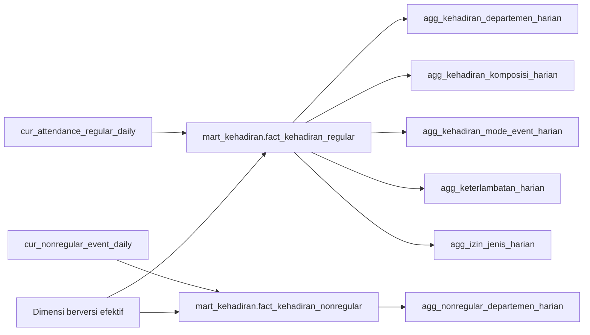

# STTM Curated ke Mart dan Serving — Kehadiran

Status: **terkunci untuk implementasi**.

Dokumen ini menetapkan pemetaan data curated ke fakta mart, agregasi serving,
dan dataset dashboard. Curated adalah sumber tunggal aturan bisnis; mart dan
serving tidak menghitung ulang pairing event, kewajiban kerja, izin overlap,
status kehadiran, atau keterlambatan.

## 1. Arsitektur dan tanggung jawab



| Lapisan | Tanggung jawab |
|---|---|
| Curated | Menetapkan grain pegawai-hari, pairing event, kewajiban, izin, status, mode event, keterlambatan, dan review. |
| Mart | Lookup surrogate key versi efektif, salin hasil curated, bentuk measure `0/1`, simpan metadata load. |
| Serving | Menjumlahkan measure fakta pada grain konsumsi dashboard. |
| Dashboard | Menampilkan KPI dan visual; tidak menghitung ulang aturan bisnis. |

## 2. Fakta regular

Target: `mart_kehadiran.fact_kehadiran_regular`.

Grain dan kunci unik:

```text
pegawai × tanggal kerja
UNIQUE (pegawai_id_sumber, tanggal)
```

| Kolom mart | Sumber / aturan |
|---|---|
| `tanggal_key` | Lookup `dim_calendar` dari `cur_attendance_regular_daily.tanggal`. |
| `pegawai_key` | Lookup `dim_pegawai` versi efektif dari `pegawai_id` pada `tanggal`. |
| `departemen_key` | Lookup `dim_departemen` versi efektif dari `departemen_id` pada `tanggal`. |
| `shift_key` | Lookup `dim_shift` dari `late_schedule_id_sumber`; nullable bila jadwal tidak tunggal atau tidak tervalidasi. |
| `pegawai_id_sumber`, `departemen_id_sumber`, `tanggal` | Salin dari curated untuk audit dan key upsert. |
| Kewajiban, event, izin, status, keterlambatan, review | Salin dari kolom curated dengan arti yang sama. |
| `checkin_mode_kerja`, `checkout_mode_kerja` | Mode dari event check-in pertama dan check-out terakhir yang dipilih curated. Nilai: `WFO`, `WFH`, `UNKNOWN`, atau `MIXED`. |
| `source_snapshot_at`, `mart_loaded_at` | Waktu snapshot curated dan waktu load mart. |

Measure mart dibentuk tanpa mengubah aturan curated:

```text
scheduled_regular_days   = is_expected_workday ? 1 : 0
checkin_days             = has_masuk ? 1 : 0
checkout_days            = has_pulang ? 1 : 0
complete_attendance_days = is_complete_attendance ? 1 : 0
leave_days               = has_full_day_leave ? 1 : 0
partial_leave_days       = has_partial_day_leave ? 1 : 0
absent_days              = status_kehadiran = 'TANPA_KETERANGAN' ? 1 : 0
late_days                = is_late ? 1 : 0
```

Seorang pegawai yang memiliki beberapa event masuk tetap memiliki
`checkin_days=1`; jumlah event mentah berada pada `checkin_event_count`.
`is_kpi_final` hanya bernilai true bila baris tidak perlu review dan status
kehadiran telah ditetapkan.

## 3. Fakta non-regular

Target: `mart_kehadiran.fact_kehadiran_nonregular`.

```text
Grain  : pegawai × tanggal kerja × jadwal non-regular
UNIQUE : (pegawai_id_sumber, tanggal, jadwal_id_sumber)
```

Fakta menyalin event masuk/pulang, jumlah event, waktu pertama/terakhir, mode,
manual flag, serta audit dari `cur_nonregular_event_daily`; ia melookup key
tanggal, pegawai, departemen, dan shift. Fakta ini tidak memiliki kewajiban
regular, izin, tanpa keterangan, maupun attendance rate.

## 4. Agregasi serving dan kontrak dashboard

### 4.1 `serving.agg_kehadiran_departemen_harian`

```text
Grain  : tanggal × departemen
UNIQUE : (tanggal_key, departemen_key)
```

Sumber: `fact_kehadiran_regular`. Nilai `SUM(checkin_days)` dan
`SUM(checkout_days)` berarti jumlah pegawai unik yang memiliki minimal satu
event terkait pada hari tersebut, karena grain fakta sudah pegawai-hari.

| Kolom serving | Aturan |
|---|---|
| `scheduled_regular_days`, `checkin_days`, `checkout_days`, `complete_attendance_days`, `leave_days`, `partial_leave_days`, `absent_days`, `late_days`, `late_minutes` | `SUM` measure fakta. |
| `wfo_checkin_days`, `wfh_checkin_days` | `SUM(checkin_days)` menurut `checkin_mode_kerja`. |
| `unknown_mode_checkin_days` | `SUM(checkin_days)` untuk `UNKNOWN` atau `MIXED`. |
| `wfo_checkout_days`, `wfh_checkout_days` | `SUM(checkout_days)` menurut `checkout_mode_kerja`. |
| `unknown_mode_checkout_days` | `SUM(checkout_days)` untuk `UNKNOWN` atau `MIXED`. |
| `review_rows`, `final_rows` | Jumlah baris fakta review/final. |
| `is_provisional` | True bila tanggal belum closed atau masih memiliki review. |

Dashboard memakai tabel ini untuk kartu KPI, rate, dan rekap departemen.

```text
checkin_rate    = 100 * checkin_days / NULLIF(scheduled_regular_days, 0)
attendance_rate = 100 * complete_attendance_days / NULLIF(scheduled_regular_days, 0)
```

### 4.2 `serving.agg_kehadiran_komposisi_harian`

```text
Grain  : tanggal × departemen × status_kehadiran
UNIQUE : (tanggal_key, departemen_key, status_kehadiran)
```

Sumber: fakta regular final. Tabel menyimpan `employee_days` dan measure status
yang relevan. Ia menjelaskan komponen performa departemen, misalnya
`HADIR_LENGKAP`, `CHECKIN_BELUM_PULANG`, `IZIN`, dan `TANPA_KETERANGAN`.
Ia bukan sumber KPI utama; total KPI tetap berasal dari agregasi
departemen-harian.

### 4.3 `serving.agg_kehadiran_mode_event_harian`

```text
Grain  : tanggal × departemen × jenis_event × mode_kerja
UNIQUE : (tanggal_key, departemen_key, jenis_event, mode_kerja)
```

`jenis_event` bernilai `CHECKIN` atau `CHECKOUT`; `mode_kerja` bernilai `WFO`,
`WFH`, `UNKNOWN`, atau `MIXED`. Sumbernya fakta regular dan tabel ini dipakai
untuk grafik WFO/WFH check-in maupun check-out. Setiap facts pegawai-hari
berkontribusi paling banyak satu kali bagi setiap `jenis_event`.

### 4.4 `serving.agg_keterlambatan_harian`

```text
Grain  : tanggal × departemen × bucket_keterlambatan
```

Sumber: fakta regular final dengan `late_days=1`. Kolom utama adalah
`late_employee_days`, `late_minutes`, dan `avg_late_minutes`.
Bucket awal: `1-15`, `16-30`, `31-60`, dan `>60` menit.

### 4.5 `serving.agg_izin_jenis_harian`

```text
Grain  : tanggal × departemen × jenis_izin
```

Sumber: fakta regular. Fakta harus menyimpan `selected_jenis_izin_key`, yaitu
satu jenis izin kanonik yang telah dipilih curated saat terdapat overlap.
Kolom utama: `leave_employee_days`, `partial_leave_employee_days`, dan
`is_provisional`. Satu pegawai-hari hanya berkontribusi ke satu jenis izin agar
total komposisi tidak melebihi total izin.

### 4.6 `serving.agg_nonregular_departemen_harian`

```text
Grain  : tanggal × departemen
```

Sumber: fakta non-regular. Kolom utama:

```text
checkin_employee_count  = COUNT(DISTINCT pegawai_key) dengan has_masuk
checkout_employee_count = COUNT(DISTINCT pegawai_key) dengan has_pulang
complete_employee_count = COUNT(DISTINCT pegawai_key) dengan presensi lengkap
checkin_schedule_count  = SUM(has_masuk)
checkout_schedule_count = SUM(has_pulang)
```

Jumlah pegawai dan jumlah jadwal dipisahkan karena seorang pegawai dapat
memiliki lebih dari satu jadwal non-regular pada hari yang sama.

## 5. Refresh incremental dan watermark

### 5.1 State kontrol

Simpan satu baris watermark per sumber yang diambil secara incremental:

```text
pipeline_name
source_name
watermark_updated_at
watermark_source_id
last_successful_run_at
last_run_id
```

Watermark adalah pasangan terurut `(updated_at, id)`, bukan timestamp saja.
Pasangan itu menghindari event yang terlewat saat banyak baris memiliki
`updated_at` sama. Watermark hanya dinaikkan setelah seluruh transaksi run
raw → curated → mart → serving berhasil.

Sumber minimum yang memiliki watermark sendiri:

```text
t_checkinout
t_perizinan
```

Master pegawai, departemen, shift, jadwal, kalender, dan libur diproses sebagai
snapshot harian. Perubahan master membentuk snapshot untuk tanggal terbuka;
ia tidak diam-diam mengubah fakta tanggal tertutup.

### 5.2 Batas run dan overlap

Pada awal run, ETL mengambil batas atas tetap dari sumber:

```text
upper_bound = MAX(updated_at, id) yang terlihat pada awal run
```

Baris sumber yang diproses berada pada interval:

```text
(watermark_lama - overlap, 0) sampai upper_bound
```

Gunakan overlap waktu yang dikonfigurasi, misalnya 48 jam, untuk menoleransi
timestamp sumber yang terlambat, pembaruan tertunda, dan kegagalan sebagian.
Baris yang terbaca ulang aman karena raw, curated, dan fact memakai upsert key
bisnis. Setelah sukses, watermark disetel tepat ke `upper_bound`, bukan ke
waktu server saat job selesai.

### 5.3 Daftar dampak (`dirty keys`)

Setiap perubahan dikonversi menjadi daftar pegawai-tanggal terdampak sebelum
curated dihitung ulang.

| Perubahan sumber | Dirty key yang dibuat |
|---|---|
| Event check-in/out baru atau berubah | Pegawai dan tanggal kerja event, termasuk tanggal pasangan untuk event lintas tengah malam. |
| Event dikoreksi pindah pegawai, tanggal, atau departemen | Key sebelum dan sesudah perubahan. Raw menyimpan versi sebelumnya atau change log agar key lama tidak tertinggal. |
| Izin baru/berubah/dibatalkan | Semua tanggal pada gabungan rentang lama dan rentang baru. |
| Perubahan status/approval izin | Semua tanggal rentang izin terkait. |
| Snapshot master pada tanggal terbuka | Pegawai-tanggal yang terpengaruh dalam periode terbuka; tanggal tertutup hanya melalui reprocess eksplisit. |

Daftar ini menggerakkan urutan berikut:

```text
dirty pegawai-tanggal
→ upsert curated regular/non-regular
→ upsert fakta mart
→ dirty tanggal-departemen
→ rebuild agregasi serving per partisi
```

Agregasi serving tidak diubah dengan menambah atau mengurangi delta. Untuk
setiap `tanggal × departemen` dirty, agregasi dihitung ulang dari seluruh fakta
pada partisi tersebut. Ini menghindari total salah ketika event dikoreksi,
dihapus, atau pegawai berpindah departemen.

### 5.4 Check-in dan check-out pada batch berbeda

Check-in menghasilkan fakta provisional dengan `checkin_days=1` dan
`complete_attendance_days=0`. Ketika check-out untuk pegawai-tanggal sama
masuk pada batch berikutnya, key yang sama menjadi dirty, curated dan fakta
di-upsert, lalu partisi agregasi terkait dibangun ulang. Akibatnya
`checkout_days` dan `complete_attendance_days` bertambah tanpa menggandakan
check-in.

### 5.5 Close tanggal dan koreksi historis

Semua timestamp event ditafsirkan dalam Asia/Jakarta. Tanggal tetap
`provisional` sampai melewati waktu close yang dikonfigurasi setelah seluruh
shift hari tersebut berakhir. Nilai awal yang direkomendasikan adalah close
pada **02:00 WIB di hari berikutnya**, dengan penyesuaian bila terdapat shift
yang selesai lebih lambat.

Setelah close, refresh master tidak mengubah hasil historis. Event atau izin
yang terlambat tetap diterima, tetapi diproses melalui `reprocess` eksplisit
untuk tanggal terdampak; run tersebut menyimpan alasan, waktu, dan versi aturan
revisi. Dashboard menampilkan `is_provisional` sampai tanggal benar-benar
closed dan tidak memiliki baris review.
